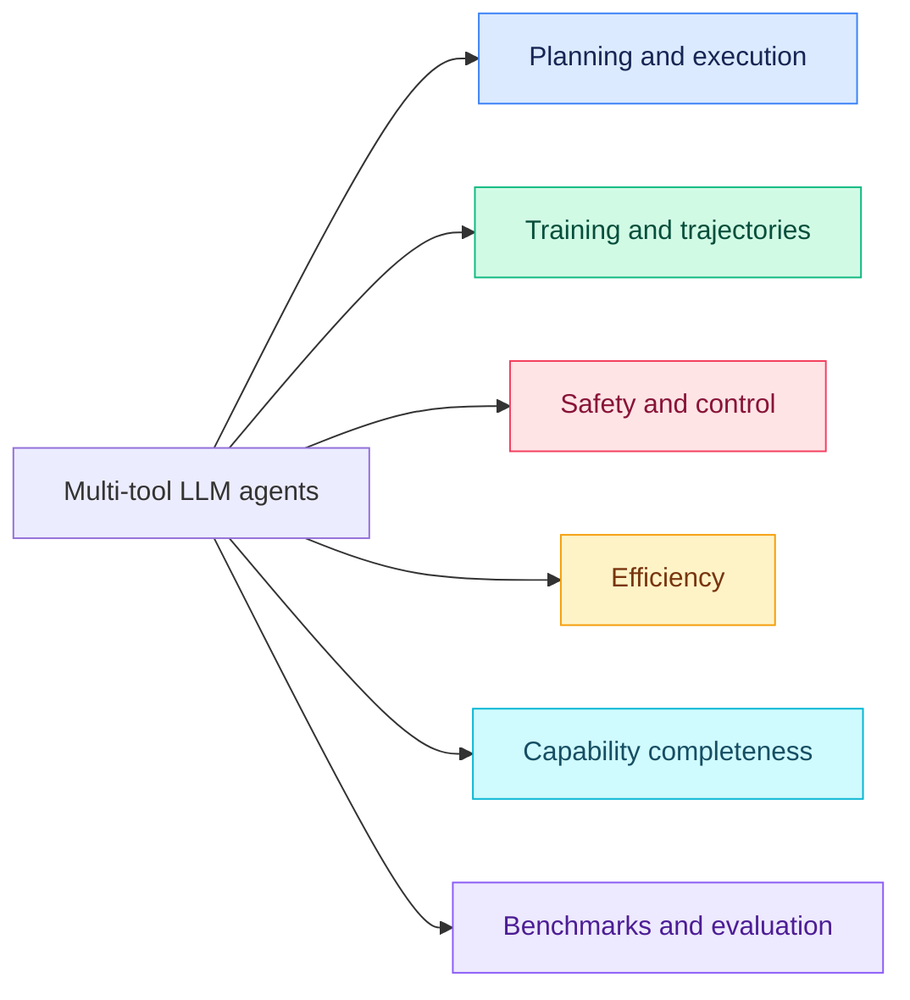

<h1 align="center">🧰 Awesome Multi-Tool LLM Agents</h1>

<h3 align="center">From Single-Tool Calls to Multi-Tool Orchestration</h3>

<p align="center">
  <a href="https://awesome.re"></a>
  <a href="https://doi.org/10.1007/s10462-026-11700-9"></a>
  <a href="https://doi.org/10.1007/s10462-026-11700-9"></a>
  <a href="https://doi.org/10.1007/s10462-026-11700-9"></a>
  <a href="https://github.com/HaoyuanXu/awesome-multi-tool-agents/stargazers"></a>
  <a href="https://github.com/HaoyuanXu/awesome-multi-tool-agents/forks"></a>
  <a href="https://github.com/HaoyuanXu/awesome-multi-tool-agents/commits/main"></a>
  <a href="https://github.com/HaoyuanXu/awesome-multi-tool-agents/issues"></a>
  <a href="CONTRIBUTING.md"></a>
  <a href="citation.ris"></a>
  <a href="data/README.md"></a>
</p>

<p align="center">
  <a href="https://doi.org/10.1007/s10462-026-11700-9"><b>The evolution of tool use in LLM agents: from single-tool call to multi-tool orchestration</b></a>
</p>

<div align="center">
<b>Haoyuan Xu</b><sup>1,*</sup>,
<b>Chang Li</b><sup>1,*</sup>,
<b>Xinyan Ma</b><sup>1,*</sup>,
<b>Xianhao Ou</b><sup>1,*</sup>,
<b>Zihan Zhang</b><sup>2</sup>,
<b>Tao He</b><sup>1</sup>,
<b>Xiangyu Liu</b><sup>1</sup>,
<b>Zixiang Wang</b><sup>1</sup>,
<b>Jiafeng Liang</b><sup>1</sup>,
<b>Zheng Chu</b><sup>1</sup>,
<b>Runxuan Liu</b><sup>1</sup>,
<b>Rongchuan Mu</b><sup>1</sup>,
<b>Dandan Tu</b><sup>3</sup>,
<b>Ming Liu</b><sup>1,†</sup>,
<b>Bing Qin</b><sup>1</sup>
</div>

<p align="center">
  <sup>1</sup> Harbin Institute of Technology, Harbin, Heilongjiang, China<br/>
  <sup>2</sup> Harvard University, Cambridge, MA, USA<br/>
  <sup>3</sup> Huawei Technologies Co., Ltd., Shenzhen, China
</p>

<p align="center">
  <sup>*</sup> Equal contribution &nbsp;·&nbsp; <sup>†</sup> Corresponding author: Ming Liu
</p>

<p align="center">
  <a href="https://doi.org/10.1007/s10462-026-11700-9"></a>
</p>

<p align="center">
  <a href="#introduction">📌 Introduction</a> · <a href="#taxonomy">🗂️ Taxonomy</a> · <a href="#paper-list">📑 Paper List</a> · <a href="#benchmarks">🧪 Benchmarks</a> · <a href="#star-history">⭐ Star History</a> · <a href="#citation">📚 Citation</a>
</p>

<a id="news"></a>
## 🗞️ News

- 🚀 **2026-11-04** — Companion repository released with the classified paper list and the survey's six-dimensional taxonomy.
- 📖 **2026-10-27** — Our survey was published in **[Artificial Intelligence Review](https://doi.org/10.1007/s10462-026-11700-9)**.

<a id="introduction"></a>
## 📌 Introduction

Multi-tool agents coordinate actions whose **ordering, arguments, or success conditions depend on earlier observations, tool results, or changes to the environment**. Moving beyond a single function call brings planning, shared state, execution feedback, recovery, and resource constraints into the same workflow.

This repository accompanies our survey and organizes the literature around **inference-time planning and execution, training and trajectory construction, safety and control, efficiency, capability completeness, and evaluation**, together with applications in software engineering, enterprise workflows, GUI/web systems, and mobile environments.

> 💡 **Explore the catalogs, suggest a paper, or share an official implementation. Contributions through issues and pull requests are welcome!**

<a id="taxonomy"></a>
## 🗂️ Taxonomy

Six connected dimensions organize the survey. The sections below follow the survey taxonomy and include the complete paper list.

| Research dimension and catalog | Survey | Core question |
| --- | --- | --- |
| [🧠 Inference-time planning and execution](#papers-inference) | §3 | How are dependent calls planned, coordinated, and repaired? |
| [🎓 Training and trajectory construction](#papers-training) | §4 | How are executable tool-use behaviors acquired? |
| [🛡️ Safety and execution control](#papers-safety) | §5 | How are actions checked and shared state protected? |
| [⚡ Efficiency](#papers-efficiency) | §6 | How can latency and cost be reduced while preserving dependencies? |
| [🌍 Capability completeness](#papers-capability-completeness) | §7 | What happens when tools, information, or reusable skills are missing? |
| [🧪 Benchmarks and evaluation](#papers-benchmarks) | §8 | What does successful multi-tool execution require, and how is it measured? |

<details>
<summary><b>🔎 Explore the taxonomy graph</b></summary>



</details>

<a id="paper-list"></a>
## 📑 Paper List

<p align="center">
  <a href="#browse-the-papers"></a>
  <a href="#taxonomy"></a>
  <a href="#browse-the-papers"></a>
</p>

<details>
<summary><b>📅 Works by publication year</b></summary>

| Year | Works |
| --- | ---: |
| **2026** | 56 |
| **2025** | 109 |
| **2024** | 57 |
| **2023** | 17 |
| **2022** | 2 |

</details>

<a id="browse-the-papers"></a>
### 📂 Browse the Papers

| Topic | Works |
| --- | ---: |
| 📖 [Foundations and Related Surveys](#papers-foundations) | 12 |
| 🧠 [Inference-Time Planning and Execution](#papers-inference) | 43 |
| 🎓 [Training and Trajectory Construction](#papers-training) | 42 |
| 🛡️ [Safety and Execution Control](#papers-safety) | 28 |
| ⚡ [Efficiency under Resource Constraints](#papers-efficiency) | 23 |
| 🌍 [Capability Completeness](#papers-capability-completeness) | 13 |
| 🧪 [Benchmarks and Evaluation](#papers-benchmarks) | 45 |
| 🧑‍💻 [Applications and Open Problems](#papers-applications) | 35 |

<a id="papers-foundations"></a>
### 📖 Foundations and Related Surveys

<a id="papers-foundations-overview"></a>
#### 📂 Overview

- **[2024]** 📄 [Large Language Models: A Survey](https://arxiv.org/abs/2402.06196) 
- **[2023]** 📄 [Toolformer: Language Models Can Teach Themselves to Use Tools](https://doi.org/10.52202/075280-2997) 
- **[2022]** 📄 [MRKL Systems: A modular, neuro-symbolic architecture that combines large language models, external knowledge sources and discrete reasoning](https://arxiv.org/abs/2205.00445) 
- **[2022]** 📄 [TALM: Tool Augmented Language Models](https://arxiv.org/abs/2205.12255) 

<a id="papers-foundations-related-work"></a>
#### 📂 Related Work

- **[2025]** 📄 [A Review of Prominent Paradigms for LLM-Based Agents: Tool Use, Planning (Including RAG), and Feedback Learning](https://aclanthology.org/2025.coling-main.652/) 
- **[2025]** 📄 [Evaluation and Benchmarking of LLM Agents: A Survey](https://doi.org/10.1145/3711896.3736570) 
- **[2025]** 📄 [Large Language Model Agent: A Survey on Methodology, Applications and Challenges](https://arxiv.org/abs/2503.21460) 
- **[2025]** 📄 [Tool Learning with Foundation Models](https://doi.org/10.1145/3704435) 
- **[2025]** 📄 [Tool learning with large language models: a survey](https://doi.org/10.1007/s11704-024-40678-2) 
- **[2024]** 📄 [A Survey on LLM-based Multi-Agent System: Recent Advances and New Frontiers in Application](https://arxiv.org/abs/2412.17481) 
- **[2024]** 📄 [LLM With Tools: A Survey](https://arxiv.org/abs/2409.18807) 
- **[2024]** 📄 [What Are Tools Anyway? A Survey from the Language Model Perspective](https://openreview.net/forum?id=Xh1B90iBSR) 

<a id="papers-inference"></a>
### 🧠 Inference-Time Planning and Execution

<a id="papers-inference-topological-planning"></a>
#### 📂 Topological Planning

- **[2026]** 📄 [ARTIS: Agentic Risk-Aware Test-Time Scaling via Iterative Simulation](https://arxiv.org/abs/2602.01709) 
- **[2026]** 📄 [AutoTool: Efficient tool selection for large language model agents](https://doi.org/10.1609/aaai.v40i37.40389) 
- **[2026]** 📄 [STRUCTUREDAGENT: Planning with AND/OR Trees for Long-Horizon Web Tasks](https://arxiv.org/abs/2603.05294) 
- **[2025]** 📄 [AFlow: Automating Agentic Workflow Generation](https://proceedings.iclr.cc/paper_files/paper/2025/file/5492ecbce4439401798dcd2c90be94cd-Paper-Conference.pdf) 
- **[2025]** 📄 [AgentPro: Enhancing LLM Agents with Automated Process Supervision](https://doi.org/10.18653/v1/2025.emnlp-main.506) 
- **[2025]** 📄 [DyFlow: Dynamic Workflow Framework for Agentic Reasoning](https://doi.org/10.52202/085713-5793) 
- **[2025]** 📄 [GAP: Graph-Based Agent Planning with Parallel Tool Use and Reinforcement Learning](https://arxiv.org/abs/2510.25320) 
- **[2025]** 📄 [HiPlan: Hierarchical Planning for LLM-Based Agents with Adaptive Global-Local Guidance](https://arxiv.org/abs/2508.19076) 
- **[2025]** 📄 [MPO: Boosting LLM Agents with Meta Plan Optimization](https://doi.org/10.18653/v1/2025.findings-emnlp.210) 
- **[2025]** 📄 [Plan-and-Act: Improving Planning of Agents for Long-Horizon Tasks](https://proceedings.mlr.press/v267/erdogan25a.html) 
- **[2025]** 📄 [ReCAP: Recursive Context-Aware Reasoning and Planning for Large Language Model Agents](https://doi.org/10.52202/085713-3181) 
- **[2025]** 📄 [Smurfs: Multi-Agent System using Context-Efficient DFSDT for Tool Planning](https://doi.org/10.18653/v1/2025.naacl-long.169) 
- **[2025]** 📄 [ToolExpNet: Optimizing Multi-Tool Selection in LLMs with Similarity and Dependency-Aware Experience Networks](https://doi.org/10.18653/v1/2025.findings-acl.811) 
- **[2025]** 📄 [Wider or Deeper? Scaling LLM Inference-Time Compute with Adaptive Branching Tree Search](https://doi.org/10.52202/085713-1191) 
- **[2024]** 📄 [ADaPT: As-Needed Decomposition and Planning with Language Models](https://doi.org/10.18653/v1/2024.findings-naacl.264) 
- **[2024]** 📄 [Dynamic Planning for LLM-based Graphical User Interface Automation](https://doi.org/10.18653/v1/2024.findings-emnlp.70) 
- **[2024]** 📄 [Graph-enhanced Large Language Models in Asynchronous Plan Reasoning](https://proceedings.mlr.press/v235/lin24k.html) 
- **[2024]** 📄 [ToolNet: Connecting Large Language Models with Massive Tools via Tool Graph](https://arxiv.org/abs/2403.00839) 
- **[2023]** 📄 [ReAct: Synergizing Reasoning and Acting in Language Models](https://openreview.net/forum?id=WE_vluYUL-X) 

<a id="papers-inference-long-horizon-orchestration"></a>
#### 📂 Long-Horizon Orchestration

- **[2026]** 📄 [ACON: Optimizing Context Compression for Long-horizon LLM Agents](https://www.microsoft.com/en-us/research/publication/acon-optimizing-context-compression-for-long-horizon-llm-agents/) 
- **[2026]** 📄 [COMPASS: Enhancing Agent Long-Horizon Reasoning with Evolving Context](https://doi.org/10.18653/v1/2026.acl-long.152) 
- **[2026]** 📄 [DeepAgent: A General Reasoning Agent with Scalable Toolsets](https://doi.org/10.1145/3774904.3792460) 
- **[2026]** 📄 [Learning Hierarchical Procedural Memory for LLM Agents through Bayesian Selection and Contrastive Refinement](https://doi.org/10.65109/FKYO8341) 
- **[2025]** 📄 [A-Mem: Agentic Memory for LLM Agents](https://doi.org/10.52202/085713-0593) 
- **[2025]** 📄 [CodeTool: Enhancing Programmatic Tool Invocation of LLMs via Process Supervision](https://doi.org/10.18653/v1/2025.acl-long.895) 
- **[2025]** 📄 [Gradientsys: A Multi-Agent LLM Scheduler with ReAct Orchestration](https://arxiv.org/abs/2507.06520) 
- **[2025]** 📄 [HiAgent: Hierarchical Working Memory Management for Solving Long-Horizon Agent Tasks with Large Language Model](https://doi.org/10.18653/v1/2025.acl-long.1575) 
- **[2025]** 📄 [MARS: Co-evolving Dual-System Deep Research via Multi-Agent Reinforcement Learning](https://arxiv.org/abs/2510.04935) 
- **[2025]** 📄 [MIRIX: Multi-Agent Memory System for LLM-Based Agents](https://arxiv.org/abs/2507.07957) 
- **[2025]** 📄 [SEDM: Scalable Self-Evolving Distributed Memory for Agents](https://arxiv.org/abs/2509.09498) 
- **[2025]** 📄 [Tool-to-Agent Retrieval: Bridging Tools and Agents for Scalable LLM Multi-Agent Systems](https://arxiv.org/abs/2511.01854) 
- **[2025]** 📄 [Towards a Science of Scaling Agent Systems](https://arxiv.org/abs/2512.08296) 
- **[2024]** 📄 [Small LLMs Are Weak Tool Learners: A Multi-LLM Agent](https://doi.org/10.18653/v1/2024.emnlp-main.929) 
- **[2023]** 📄 [HuggingGPT: Solving AI Tasks with ChatGPT and its Friends in Hugging Face](https://doi.org/10.52202/075280-1657) 

<a id="papers-inference-agent-self-improvement"></a>
#### 📂 Agent Self-Improvement

- **[2026]** 📄 [Beyond Static Tools: Test-Time Tool Evolution for Scientific Reasoning](https://arxiv.org/abs/2601.07641) 
- **[2026]** 📄 [Failure makes the agent stronger: Enhancing Accuracy through Structured Reflection for Reliable Tool Interactions](https://doi.org/10.18653/v1/2026.findings-acl.618) 
- **[2026]** 📄 [PreFlect: From Retrospective to Prospective Reflection in Large Language Model Agents](https://arxiv.org/abs/2602.07187) 
- **[2026]** 📄 [SPIRAL: Symbolic LLM Planning via Grounded and Reflective Search](https://doi.org/10.1609/aaai.v40i43.40975) 
- **[2026]** 📄 [SWE-Adept: An LLM-Based Agentic Framework for Deep Codebase Analysis and Structured Issue Resolution](https://arxiv.org/abs/2603.01327) 
- **[2025]** 📄 [From Exploration to Mastery: Enabling LLMs to Master Tools via Self-Driven Interactions](https://proceedings.iclr.cc/paper_files/paper/2025/file/8c22e5e918198702765ecff4b20d0a90-Paper-Conference.pdf) 
- **[2025]** 📄 [MetaAgent: Toward Self-Evolving Agent via Tool Meta-Learning](https://arxiv.org/abs/2508.00271) 
- **[2025]** 📄 [SAGE: Self-evolving Agents with Reflective and Memory-augmented Abilities](https://doi.org/10.1016/j.neucom.2025.130470) 
- **[2023]** 📄 [Reflexion: language agents with verbal reinforcement learning](https://doi.org/10.52202/075280-0377) 

<a id="papers-training"></a>
### 🎓 Training and Trajectory Construction

<a id="papers-training-reinforcement-learning"></a>
#### 📂 Reinforcement Learning

- **[2026]** 📄 [Agent-R1: A Unified and Modular Framework for Agentic Reinforcement Learning](https://arxiv.org/abs/2511.14460) 
- **[2026]** 📄 [Agentic Reinforced Policy Optimization](https://iclr.cc/virtual/2026/poster/10009306) 
- **[2026]** 📄 [Empowering Multi-Turn Tool-Integrated Agentic Reasoning with Group Turn Policy Optimization](https://doi.org/10.18653/v1/2026.acl-long.1962) 
- **[2026]** 📄 [Progra: Progress-Aware Reinforcement Learning for Multi-Turn Function Calling](https://doi.org/10.18653/v1/2026.findings-acl.325) 
- **[2026]** 📄 [Tool-Star: Empowering Multi-Tool Collaborative Web Agent via Reinforcement Learning](https://doi.org/10.1145/3805712.3809712) 
- **[2025]** 📄 [PORTool: Importance-Aware Policy Optimization with Rewarded Tree for Multi-Tool-Integrated Reasoning](https://arxiv.org/abs/2510.26020) 
- **[2025]** 📄 [RAGEN: Understanding Self-Evolution in LLM Agents via Multi-Turn Reinforcement Learning](https://arxiv.org/abs/2504.20073) 
- **[2025]** 📄 [Reinforcing Multi-Turn Reasoning in LLM Agents via Fine-Grained Reward Structure and Credit Assignment](https://arxiv.org/abs/2505.11821) 
- **[2025]** 📄 [ToolRL: Reward is All Tool Learning Needs](https://doi.org/10.52202/085713-3524) 
- **[2025]** 📄 [ToolRM: Outcome Reward Models for Tool-Calling Large Language Models](https://arxiv.org/abs/2509.11963) 
- **[2025]** 📄 [ToRL: Scaling Tool-Integrated RL](https://arxiv.org/abs/2503.23383) 

<a id="papers-training-training-free-methods"></a>
#### 📂 Training-free Methods

- **[2026]** 📄 [ToolDreamer: Instilling LLM Reasoning Into Tool Retrievers](https://doi.org/10.18653/v1/2026.eacl-long.254) 
- **[2025]** 📄 [EASYTOOL: Enhancing LLM-based Agents with Concise Tool Instruction](https://doi.org/10.18653/v1/2025.naacl-long.44) 
- **[2025]** 📄 [GenTool: Enhancing Tool Generalization in Language Models through Zero-to-One and Weak-to-Strong Simulation](https://doi.org/10.18653/v1/2025.findings-acl.61) 
- **[2025]** 📄 [MCP-Zero: Active Tool Discovery for Autonomous LLM Agents](https://arxiv.org/abs/2506.01056) 
- **[2025]** 📄 [Memento: Fine-tuning LLM Agents without Fine-tuning LLMs](https://arxiv.org/abs/2508.16153) 
- **[2025]** 📄 [PLAY2PROMPT: Zero-shot Tool Instruction Optimization for LLM Agents via Tool Play](https://doi.org/10.18653/v1/2025.findings-acl.1347) 
- **[2024]** 📄 [AnyTool: Self-Reflective, Hierarchical Agents for Large-Scale API Calls](https://proceedings.mlr.press/v235/du24h.html) 
- **[2024]** 📄 [Re-Invoke: Tool Invocation Rewriting for Zero-Shot Tool Retrieval](https://doi.org/10.18653/v1/2024.findings-emnlp.270) 
- **[2024]** 📄 [ToolLLM: Facilitating Large Language Models to Master 16000+ Real-world APIs](https://proceedings.iclr.cc/paper_files/paper/2024/file/28e50ee5b72e90b50e7196fde8ea260e-Paper-Conference.pdf)  · [💻 Code](https://github.com/OpenBMB/ToolBench)

<a id="papers-training-multi-tool-trajectory-data-synthesis"></a>
#### 📂 Multi-Tool Trajectory Data Synthesis

- **[2026]** 📄 [ASTRA: Automated Synthesis of agentic Trajectories and Reinforcement Arenas](https://arxiv.org/abs/2601.21558) 
- **[2026]** 📄 [LoopTool: Closing the Data--Training Loop for Robust LLM Tool Calls](https://doi.org/10.18653/v1/2026.acl-long.968) 
- **[2026]** 📄 [ToolACE-R: Model-aware Iterative Training and Adaptive Refinement for Tool learning](https://doi.org/10.1609/aaai.v40i41.40759) 
- **[2026]** 📄 [Training Verifier to Assessing Complex Real-World Tool-Use Trajectories](https://doi.org/10.18653/v1/2026.findings-acl.1647) 
- **[2026]** 📄 [Unlocking Implicit Experience: Synthesizing Tool-Use Trajectories from Text](https://doi.org/10.18653/v1/2026.acl-long.452) 
- **[2025]** 📄 [Facilitating Multi-turn Function Calling for LLMs via Compositional Instruction Tuning](https://proceedings.iclr.cc/paper_files/paper/2025/file/69c49f75ca31620f1f0d38093d9f3d9b-Paper-Conference.pdf) 
- **[2025]** 📄 [Magnet: Multi-turn Tool-use Data Synthesis and Distillation via Graph Translation](https://doi.org/10.18653/v1/2025.acl-long.1566) 
- **[2025]** 📄 [OrchDAG: Complex Tool Orchestration in Multi-Turn Interactions with Plan DAGs](https://arxiv.org/abs/2510.24663) 
- **[2025]** 📄 [Self-Training Large Language Models for Tool-Use Without Demonstrations](https://doi.org/10.18653/v1/2025.findings-naacl.69) 
- **[2025]** 📄 [StableToolBench-MirrorAPI: Modeling Tool Environments as Mirrors of 7,000+ Real-World APIs](https://doi.org/10.18653/v1/2025.findings-acl.273) 
- **[2025]** 📄 [ToolACE-DEV: Self-Improving Tool Learning via Decomposition and EVolution](https://arxiv.org/abs/2505.07512) 
- **[2025]** 📄 [ToolACE: Winning the Points of LLM Function Calling](https://proceedings.iclr.cc/paper_files/paper/2025/file/663865ea167425c6c562cb0b6bcf76c7-Paper-Conference.pdf) 
- **[2025]** 📄 [ToolMind Technical Report: A Large-Scale, Reasoning-Enhanced Tool-Use Dataset](https://arxiv.org/abs/2511.15718) 
- **[2024]** 📄 [APIGen: Automated Pipeline for Generating Verifiable and Diverse Function-Calling Datasets](https://doi.org/10.52202/079017-1725) 
- **[2024]** 📄 [Seal-Tools: Self-instruct Tool Learning Dataset for Agent Tuning and Detailed Benchmark](https://doi.org/10.1007/978-981-97-9434-8_29) 

<a id="papers-training-supervised-fine-tuning"></a>
#### 📂 Supervised Fine-Tuning

- **[2025]** 📄 [Can a Single Model Master Both Multi-turn Conversations and Tool Use? CoALM: A Unified Conversational Agentic Language Model](https://doi.org/10.18653/v1/2025.acl-long.605) 
- **[2025]** 📄 [Efficient Tool Use with Chain-of-Abstraction Reasoning](https://aclanthology.org/2025.coling-main.185/) 
- **[2025]** 📄 [Robust Function-Calling for On-Device Language Models via Function Masking](https://proceedings.iclr.cc/paper_files/paper/2025/file/d45e0bfb5a39477d56b55c0824200008-Paper-Conference.pdf) 
- **[2025]** 📄 [ToolGen: Unified Tool Retrieval and Calling via Generation](https://proceedings.iclr.cc/paper_files/paper/2025/file/b646bdebeb87dfafe2c6f77a63b564e1-Paper-Conference.pdf) 
- **[2024]** 📄 [Gorilla: Large Language Model Connected with Massive APIs](https://doi.org/10.52202/079017-4020) 
- **[2024]** 📄 [Granite-Function Calling Model: Introducing Function Calling Abilities via Multi-task Learning of Granular Tasks](https://doi.org/10.18653/v1/2024.emnlp-industry.85) 
- **[2023]** 📄 [GPT4Tools: Teaching Large Language Model to Use Tools via Self-instruction](https://doi.org/10.52202/075280-3149) 

<a id="papers-safety"></a>
### 🛡️ Safety and Execution Control

<a id="papers-safety-overview"></a>
#### 📂 Overview

- **[2026]** 📄 [A Survey on Agentic Security: Applications, Threats and Defenses](https://openreview.net/submissions?venue=ICLR.cc%2F2026%2FWorkshop%2FAIWILD) 
- **[2026]** 📄 [The Emerged Security and Privacy of LLM Agent: A Survey with Case Studies](https://doi.org/10.1145/3773080) 
- **[2025]** 📄 [Design Patterns for Securing LLM Agents against Prompt Injections](https://arxiv.org/abs/2506.08837) 
- **[2025]** 📄 [Prompt Flow Integrity to Prevent Privilege Escalation in LLM Agents](https://arxiv.org/abs/2503.15547) 
- **[2024]** 📄 [AgentDojo: A Dynamic Environment to Evaluate Prompt Injection Attacks and Defenses for LLM Agents](https://doi.org/10.52202/079017-2636)  · [💻 Code](https://github.com/ethz-spylab/agentdojo)
- **[2024]** 📄 [Identifying the Risks of LM Agents with an LM-Emulated Sandbox](https://proceedings.iclr.cc/paper_files/paper/2024/file/7274ed909a312d4d869cc328ad1c5f04-Paper-Conference.pdf) 
- **[2023]** 📄 [Not What You've Signed Up For: Compromising Real-World LLM-Integrated Applications with Indirect Prompt Injection](https://doi.org/10.1145/3605764.3623985) 

<a id="papers-safety-risks-in-long-horizon-tool-chains"></a>
#### 📂 Risks in Long-Horizon Tool Chains

- **[2026]** 📄 [AgentDoG: A Diagnostic Guardrail Framework for AI Agent Safety and Security](https://arxiv.org/abs/2601.18491) 
- **[2026]** 📄 [Les Dissonances: Cross-Tool Harvesting and Polluting in Pool-of-Tools Empowered LLM Agents](https://doi.org/10.14722/ndss.2026.240577) 
- **[2026]** 📄 [Think Twice Before You Act: Enhancing Agent Behavioral Safety with Thought Correction](https://jiangchangyue.github.io/publications/) 
- **[2025]** 📄 [Advancing tool-augmented large language models via meta-verification and reflection learning](https://doi.org/10.1145/3711896.3736835) 
- **[2025]** 📄 [Agent Safety Alignment via Reinforcement Learning](https://arxiv.org/abs/2507.08270) 
- **[2025]** 📄 [Butterfly Effects in Toolchains: A Comprehensive Analysis of Failed Parameter Filling in LLM Tool-Agent Systems](https://doi.org/10.18653/v1/2025.findings-emnlp.907) 
- **[2025]** 📄 [Deep Research Brings Deeper Harm](https://arxiv.org/abs/2510.11851) 
- **[2025]** 📄 [Memory Injection Attacks on LLM Agents via Query-Only Interaction](https://doi.org/10.52202/085713-1554) 
- **[2025]** 📄 [ToolReflection: Improving Large Language Models for Real-World API Calls with Self-Generated Data](https://doi.org/10.18653/v1/2025.realm-1.14) 
- **[2024]** 📄 [Language Agent Tree Search Unifies Reasoning, Acting, and Planning in Language Models](https://proceedings.mlr.press/v235/zhou24r.html) 
- **[2024]** 📄 [Making Language Models Better Tool Learners with Execution Feedback](https://doi.org/10.18653/v1/2024.naacl-long.195) 

<a id="papers-safety-risks-in-parallel-execution"></a>
#### 📂 Risks in Parallel Execution

- **[2026]** 📄 [Atomix: Timely, Transactional Tool Use for Reliable Agentic Workflows](https://arxiv.org/abs/2602.14849) 
- **[2025]** 📄 [Rethinking Stateful Tool Use in Multi-Turn Dialogues: Benchmarks and Challenges](https://doi.org/10.18653/v1/2025.findings-acl.284) 
- **[2025]** 📄 [SagaLLM: Context Management, Validation, and Transaction Guarantees for Multi-Agent LLM Planning](https://doi.org/10.14778/3750601.3750611) 

<a id="papers-safety-risks-in-parallel-execution--pre-execution-controls"></a>
#### 📂 Risks in Parallel Execution / Pre-execution Controls

- **[2026]** 📄 [AgentSpec: Customizable Runtime Enforcement for Safe and Reliable LLM Agents](https://doi.org/10.1145/3744916.3764546) 
- **[2026]** 📄 [Autonomous Action Runtime Management (AARM): A System Specification for Securing AI-Driven Actions at Runtime](https://arxiv.org/abs/2602.09433) 
- **[2025]** 📄 [World Modelling Improves Language Model Agents](https://arxiv.org/abs/2506.02918) 

<a id="papers-safety-risks-in-parallel-execution--in-execution-transaction-management"></a>
#### 📂 Risks in Parallel Execution / In-execution Transaction Management

- **[2025]** 📄 [Generator-Assistant Stepwise Rollback Framework for Large Language Model Agent](https://doi.org/10.18653/v1/2025.emnlp-main.892) 

<a id="papers-safety-risks-in-parallel-execution--post-execution-verification"></a>
#### 📂 Risks in Parallel Execution / Post-execution Verification

- **[2025]** 📄 [Divide-Verify-Refine: Can LLMs Self-align with Complex Instructions?](https://doi.org/10.18653/v1/2025.findings-acl.709) 
- **[2025]** 📄 [VerifiAgent: a Unified Verification Agent in Language Model Reasoning](https://doi.org/10.18653/v1/2025.findings-emnlp.891) 
- **[2024]** 📄 [CRITIC: Large Language Models Can Self-Correct with Tool-Interactive Critiquing](https://openreview.net/forum?id=Sx038qxjek) 

<a id="papers-efficiency"></a>
### ⚡ Efficiency under Resource Constraints

<a id="papers-efficiency-latency-in-multi-tool-chains--asynchronous-decoupling"></a>
#### 📂 Latency in Multi-Tool Chains / Asynchronous Decoupling

- **[2026]** 📄 [Incalmo: An Autonomous LLM-assisted System for Red Teaming Multi-Host Networks](https://doi.org/10.1109/SP63933.2026.00132) 
- **[2025]** 📄 [MACI: Multi-Agent Collaborative Intelligence for Adaptive Reasoning and Temporal Planning](https://arxiv.org/abs/2501.16689) 
- **[2025]** 📄 [Temac: Multi-Agent Collaboration for Automated Web GUI Testing](https://arxiv.org/abs/2506.00520) 

<a id="papers-efficiency-tool-call-cost-and-inference-budget--caching-and-external-memory"></a>
#### 📂 Tool Call Cost and Inference Budget / Caching and External Memory

- **[2023]** 📄 [GPTCache: An Open-Source Semantic Cache for LLM Applications Enabling Faster Answers and Cost Savings](https://doi.org/10.18653/v1/2023.nlposs-1.24) 
- **[2023]** 📄 [MemGPT: Towards LLMs as Operating Systems](https://arxiv.org/abs/2310.08560) 

<a id="papers-efficiency-tool-call-cost-and-inference-budget--dynamic-tool-search"></a>
#### 📂 Tool Call Cost and Inference Budget / Dynamic Tool Search

- **[2024]** 📄 [Lost in the Middle: How Language Models Use Long Contexts](https://doi.org/10.1162/tacl_a_00638) 
- **[2023]** 📄 [ToolkenGPT: Augmenting Frozen Language Models with Massive Tools via Tool Embeddings](https://doi.org/10.52202/075280-1988) 

<a id="papers-efficiency-latency-in-multi-tool-chains--speculative-planning-and-search"></a>
#### 📂 Latency in Multi-Tool Chains / Speculative Planning and Search

- **[2024]** 📄 [DSPy: Compiling Declarative Language Model Calls into State-of-the-Art Pipelines](https://proceedings.iclr.cc/paper_files/paper/2024/hash/f1cf02ce09757f57c3b93c0db83181e0-Abstract-Conference.html) 
- **[2024]** 📄 [REST: Retrieval-Based Speculative Decoding](https://doi.org/10.18653/v1/2024.naacl-long.88) 
- **[2023]** 📄 [ReWOO: Decoupling Reasoning from Observations for Efficient Augmented Language Models](https://arxiv.org/abs/2305.18323) 
- **[2023]** 📄 [Tree of Thoughts: Deliberate Problem Solving with Large Language Models](https://doi.org/10.52202/075280-0517) 

<a id="papers-efficiency-latency-in-multi-tool-chains--parallel-execution"></a>
#### 📂 Latency in Multi-Tool Chains / Parallel Execution

- **[2026]** 📄 [Parallelized Planning-Acting for Multi-Agent LLM Systems in Minecraft](https://doi.org/10.65109/EXAJ9853) 
- **[2025]** 📄 [Divide-Then-Aggregate: An Efficient Tool Learning Method via Parallel Tool Invocation](https://doi.org/10.18653/v1/2025.acl-long.1401) 
- **[2025]** 📄 [Optimizing Sequential Multi-Step Tasks with Parallel LLM Agents](https://arxiv.org/abs/2507.08944) 
- **[2024]** 📄 [An LLM Compiler for Parallel Function Calling](https://proceedings.mlr.press/v235/kim24y.html)  · [💻 Code](https://github.com/SqueezeAILab/LLMCompiler)
- **[2024]** 📄 [Skeleton-of-Thought: Prompting LLMs for Efficient Parallel Generation](https://proceedings.iclr.cc/paper_files/paper/2024/hash/03d7e13f0092405804f3a381ade8f3f0-Abstract-Conference.html) 

<a id="papers-efficiency-tool-call-cost-and-inference-budget"></a>
#### 📂 Tool Call Cost and Inference Budget

- **[2026]** 📄 [CostBench: Evaluating Multi-Turn Cost-Optimal Planning and Adaptation in Dynamic Environments for LLM Tool-Use Agents](https://doi.org/10.18653/v1/2026.acl-long.584) 
- **[2025]** 📄 [SMART: Self-Aware Agent for Tool Overuse Mitigation](https://doi.org/10.18653/v1/2025.findings-acl.239) 
- **[2023]** 📄 [EcoAssistant: Using LLM Assistant More Affordably and Accurately](https://arxiv.org/abs/2310.03046) 

<a id="papers-efficiency-tool-call-cost-and-inference-budget--adaptive-model-routing"></a>
#### 📂 Tool Call Cost and Inference Budget / Adaptive Model Routing

- **[2026]** 📄 [Orchestrating Intelligence: Confidence-Aware Routing for Efficient Multi-Agent Collaboration across Multi-Scale Models](https://arxiv.org/abs/2601.04861) 
- **[2025]** 📄 [RouteLLM: Learning to Route LLMs from Preference Data](https://openreview.net/forum?id=8sSqNntaMr) 
- **[2024]** 📄 [FrugalGPT: How to Use Large Language Models While Reducing Cost and Improving Performance](https://openreview.net/forum?id=cSimKw5p6R) 
- **[2023]** 📄 [SwiftSage: A Generative Agent with Fast and Slow Thinking for Complex Interactive Tasks](https://doi.org/10.52202/075280-1034) 

<a id="papers-capability-completeness"></a>
### 🌍 Capability Completeness

<a id="papers-capability-completeness-open-environment-adaptation"></a>
#### 📂 Open Environment Adaptation

- **[2026]** 📄 [Beyond Static Toolsets: Self-Evolving LLM Tool Agents via Continual Documentation Adaptation](https://doi.org/10.18653/v1/2026.findings-acl.1082) 
- **[2026]** 📄 [Lifelong Learning of Large Language Model Based Agents: A Roadmap](https://doi.org/10.1109/TPAMI.2025.3650546) 
- **[2025]** 📄 [AppAgent: Multimodal Agents as Smartphone Users](https://doi.org/10.1145/3706598.3713600) 
- **[2025]** 📄 [Learning Evolving Tools for Large Language Models](https://proceedings.iclr.cc/paper_files/paper/2025/file/d8d1d325f822e07d16866780cc23deb2-Paper-Conference.pdf) 
- **[2024]** 📄 [ExpeL: LLM Agents Are Experiential Learners](https://doi.org/10.1609/aaai.v38i17.29936) 
- **[2024]** 📄 [Voyager: An Open-Ended Embodied Agent with Large Language Models](https://openreview.net/forum?id=ehfRiF0R3a)  · [💻 Code](https://github.com/MineDojo/Voyager)

<a id="papers-capability-completeness-overview"></a>
#### 📂 Overview

- **[2024]** 📄 [Large Language Models as Tool Makers](https://proceedings.iclr.cc/paper_files/paper/2024/hash/ed91353f700d113e5d848c7e04a858b0-Abstract-Conference.html) 

<a id="papers-capability-completeness-capability-boundary-perception"></a>
#### 📂 Capability Boundary Perception

- **[2025]** 📄 [AskToAct: Enhancing LLMs Tool Use via Self-Correcting Clarification](https://doi.org/10.18653/v1/2025.emnlp-main.682) 
- **[2025]** 📄 [Benchmarking Failures in Tool-Augmented Language Models](https://doi.org/10.18653/v1/2025.naacl-long.149) 
- **[2025]** 📄 [ToolHaystack: Stress-Testing Tool-Augmented Language Models in Realistic Long-Term Interactions](https://doi.org/10.18653/v1/2025.findings-emnlp.1344) 

<a id="papers-capability-completeness-autonomous-tool-expansion"></a>
#### 📂 Autonomous Tool Expansion

- **[2025]** 📄 [LLM Agents Making Agent Tools](https://doi.org/10.18653/v1/2025.acl-long.1266) 
- **[2023]** 📄 [CREATOR: Tool Creation for Disentangling Abstract and Concrete Reasoning of Large Language Models](https://doi.org/10.18653/v1/2023.findings-emnlp.462) 
- **[2023]** 📄 [RestGPT: Connecting Large Language Models with Real-World RESTful APIs](https://arxiv.org/abs/2306.06624) 

<a id="papers-benchmarks"></a>
### 🧪 Benchmarks and Evaluation

<a id="papers-benchmarks-general-tool-use-evaluation-and-data"></a>
#### 📂 General Tool-Use Evaluation and Data

- **[2024]** 📄 [MetaTool Benchmark for Large Language Models: Deciding Whether to Use Tools and Which to Use](https://proceedings.iclr.cc/paper_files/paper/2024/hash/bc12914d66b41b6bfc2d3a5decdb498b-Abstract-Conference.html) 
- **[2023]** 📄 [API-Bank: A Comprehensive Benchmark for Tool-Augmented LLMs](https://doi.org/10.18653/v1/2023.emnlp-main.187) 

<a id="papers-benchmarks-topological-complexity"></a>
#### 📂 Topological Complexity

- **[2026]** 📄 [Towards Reliable Benchmarking: A Contamination Free, Controllable Evaluation Framework for Multi-step LLM Function Calling](https://openreview.net/forum?id=UKYCJixSFt) 
- **[2026]** 📄 [TRAJECT-Bench: A Trajectory-Aware Benchmark for Evaluating Agentic Tool Use](https://iclr.cc/virtual/2026/poster/10009304) 
- **[2025]** 📄 [$M^3$-Bench: Multi-Modal, Multi-Hop, Multi-Threaded Tool-Using MLLM Agent Benchmark](https://arxiv.org/abs/2511.17729) 
- **[2025]** 📄 [ComplexFuncBench: Exploring Multi-Step and Constrained Function Calling under Long-Context Scenario](https://arxiv.org/abs/2501.10132) 
- **[2025]** 📄 [DICE-BENCH: Evaluating the Tool-Use Capabilities of Large Language Models in Multi-Round, Multi-Party Dialogues](https://doi.org/10.18653/v1/2025.findings-acl.1375) 
- **[2025]** 📄 [ELT-Bench: An End-to-End Benchmark for Evaluating AI Agents on ELT Pipelines](https://doi.org/10.14778/3773749.3773750) 
- **[2025]** 📄 [NESTFUL: A Benchmark for Evaluating LLMs on Nested Sequences of API Calls](https://doi.org/10.18653/v1/2025.emnlp-main.1702) 
- **[2025]** 📄 [ToolComp: A Multi-Tool Reasoning & Process Supervision Benchmark](https://arxiv.org/abs/2501.01290) 
- **[2025]** 📄 [ToolHop: A Query-Driven Benchmark for Evaluating Large Language Models in Multi-Hop Tool Use](https://doi.org/10.18653/v1/2025.acl-long.150) 
- **[2024]** 📄 [m&m's: A Benchmark to Evaluate Tool-Use for Multi-Step Multi-Modal Tasks](https://doi.org/10.1007/978-3-031-72684-2_2) 
- **[2024]** 📄 [TaskBench: Benchmarking Large Language Models for Task Automation](https://doi.org/10.52202/079017-0148) 

<a id="papers-benchmarks-temporal-scale"></a>
#### 📂 Temporal Scale

- **[2026]** 📄 [AgentLongBench: A Controllable Long Benchmark For Long-Contexts Agents via Environment Rollouts](https://arxiv.org/abs/2601.20730) 
- **[2026]** 📄 [DeepPlanning: Benchmarking Long-Horizon Agentic Planning with Verifiable Constraints](https://doi.org/10.18653/v1/2026.acl-long.335) 
- **[2026]** 📄 [The Tool Decathlon: Benchmarking Language Agents for Diverse, Realistic, and Long-Horizon Task Execution](https://openreview.net/forum?id=z53s5p0qhf) 
- **[2026]** 📄 [TRIP-Bench: A Benchmark for Long-Horizon Interactive Agents in Real-World Scenarios](https://arxiv.org/abs/2602.01675) 
- **[2026]** 📄 [UltraHorizon: Benchmarking LLM-Agent Capabilities in Ultra Long-Horizon Scenarios](https://openreview.net/forum?id=qRNtMWrTvo) 
- **[2025]** 📄 [HammerBench: Fine-Grained Function-Calling Evaluation in Real Mobile Assistant Scenarios](https://doi.org/10.18653/v1/2025.findings-acl.175) 
- **[2025]** 📄 [ShortcutsBench: A Large-Scale Real-world Benchmark for API-based Agents](https://proceedings.iclr.cc/paper_files/paper/2025/file/c16a99558b0b4f6b10966ca9bdb98ade-Paper-Conference.pdf) 

<a id="papers-benchmarks-dynamic-environments"></a>
#### 📂 Dynamic Environments

- **[2026]** 📄 [$\tau^2$-Bench: Evaluating Conversational Agents in a Dual-Control Environment](https://openreview.net/forum?id=OC2z7iSQKa)  · [💻 Code](https://github.com/sierra-research/tau2-bench)
- **[2026]** 📄 [Benchmarking LLM Tool-Use in the Wild](https://proceedings.iclr.cc/paper_files/paper/2026/file/4fb6b4482e4e24a33a3de5b01a011eb0-Paper-Conference.pdf) 
- **[2026]** 📄 [C-World: A Computer Use Agent Environment Creator](https://doi.org/10.18653/v1/2026.acl-long.2001) 
- **[2026]** 📄 [RealWebAssist: A Benchmark for Long-Horizon Web Assistance with Real-World Users](https://doi.org/10.1609/aaai.v40i40.40742) 
- **[2026]** 📄 [VitaBench: Benchmarking LLM Agents with Versatile Interactive Tasks in Real-world Applications](https://proceedings.iclr.cc/paper_files/paper/2026/file/93fab021315170101c92e8330a56fbdb-Paper-Conference.pdf) 
- **[2025]** 📄 [$\tau$-bench: A Benchmark for Tool-Agent-User Interaction in Real-World Domains](https://proceedings.iclr.cc/paper_files/paper/2025/file/1b126cc38b8638e07bef37e7b2bb72bf-Paper-Conference.pdf) 
- **[2025]** 📄 [AndroidWorld: A Dynamic Benchmarking Environment for Autonomous Agents](https://proceedings.iclr.cc/paper_files/paper/2025/file/01a83bc2f2732a58e6aa731e659e7101-Paper-Conference.pdf) 
- **[2025]** 📄 [COMPASS: Benchmarking Constrained Optimization in LLM Agents](https://arxiv.org/abs/2510.07043) 
- **[2025]** 📄 [MTU-Bench: A Multi-granularity Tool-Use Benchmark for Large Language Models](https://proceedings.iclr.cc/paper_files/paper/2025/file/4d13b2d99519c5415661dad44ab7edcd-Paper-Conference.pdf) 
- **[2025]** 📄 [T1: A Tool-Oriented Conversational Dataset for Multi-Turn Agentic Planning](https://doi.org/10.52202/085713-3479) 
- **[2025]** 📄 [The BrowserGym Ecosystem for Web Agent Research](https://openreview.net/forum?id=5298fKGmv3) 
- **[2025]** 📄 [TheAgentCompany: Benchmarking LLM Agents on Consequential Real World Tasks](https://doi.org/10.52202/085713-0315) 
- **[2025]** 📄 [ToolSandbox: A Stateful, Conversational, Interactive Evaluation Benchmark for LLM Tool Use Capabilities](https://doi.org/10.18653/v1/2025.findings-naacl.65)  · [💻 Code](https://github.com/apple-aiml-research/ToolSandbox)
- **[2025]** 📄 [Windows Agent Arena: Evaluating Multi-Modal OS Agents at Scale](https://proceedings.mlr.press/v267/bonatti25a.html) 
- **[2024]** 📄 [AppWorld: A Controllable World of Apps and People for Benchmarking Interactive Coding Agents](https://doi.org/10.18653/v1/2024.acl-long.850)  · [💻 Code](https://github.com/StonyBrookNLP/appworld)
- **[2024]** 📄 [GTA: A Benchmark for General Tool Agents](https://doi.org/10.52202/079017-2412) 
- **[2024]** 📄 [Mobile-Bench: An Evaluation Benchmark for LLM-based Mobile Agents](https://doi.org/10.18653/v1/2024.acl-long.478) 
- **[2024]** 📄 [OSWorld: Benchmarking Multimodal Agents for Open-Ended Tasks in Real Computer Environments](https://doi.org/10.52202/079017-1650)  · [💻 Code](https://github.com/xlang-ai/OSWorld)
- **[2024]** 📄 [StableToolBench: Towards Stable Large-Scale Benchmarking on Tool Learning of Large Language Models](https://doi.org/10.18653/v1/2024.findings-acl.664) 

<a id="papers-benchmarks-state-persistence-and-self-correction"></a>
#### 📂 State Persistence and Self-Correction

- **[2026]** 📄 [ASTRA-bench: Evaluating Tool-Use Agent Reasoning and Action Planning with Personal User Context](https://arxiv.org/abs/2603.01357) 
- **[2026]** 📄 [ColorBench: Benchmarking Mobile Agents with Graph-Structured Framework for Complex Long-Horizon Tasks](https://doi.org/10.1145/3774904.3792215) 
- **[2025]** 📄 [CRITICTOOL: Evaluating Self-Critique Capabilities of Large Language Models in Tool-Calling Error Scenarios](https://doi.org/10.18653/v1/2025.emnlp-main.1355) 
- **[2025]** 📄 [OdysseyBench: Evaluating LLM Agents on Long-Horizon Complex Office Application Workflows](https://arxiv.org/abs/2508.09124) 

<a id="papers-benchmarks-safety-and-robustness-evaluation"></a>
#### 📂 Safety and Robustness Evaluation

- **[2024]** 📄 [RoTBench: A Multi-Level Benchmark for Evaluating the Robustness of Large Language Models in Tool Learning](https://doi.org/10.18653/v1/2024.emnlp-main.19) 
- **[2024]** 📄 [ToolSword: Unveiling Safety Issues of Large Language Models in Tool Learning Across Three Stages](https://doi.org/10.18653/v1/2024.acl-long.119) 

<a id="papers-applications"></a>
### 🧑‍💻 Applications and Open Problems

<a id="papers-applications-cross-domain-deployment-requirements"></a>
#### 📂 Cross-Domain Deployment Requirements

- **[2026]** 📄 [Beyond Task Completion: An Assessment Framework for Evaluating Agentic AI Systems](https://doi.org/10.1145/3786167.3788414) 
- **[2026]** 📄 [ST-WebAgentBench: A Benchmark for Evaluating Safety and Trustworthiness in Web Agents](https://proceedings.iclr.cc/paper_files/paper/2026/file/c6c29e590e3c62e37e6b39cdd6baf2e8-Paper-Conference.pdf) 
- **[2025]** 📄 [FocusAgent: Simple Yet Effective Ways of Trimming the Large Context of Web Agents](https://arxiv.org/abs/2510.03204) 
- **[2024]** 📄 [AgentOps: Enabling Observability of LLM Agents](https://arxiv.org/abs/2411.05285) 
- **[2024]** 📄 [InjecAgent: Benchmarking Indirect Prompt Injections in Tool-Integrated Large Language Model Agents](https://doi.org/10.18653/v1/2024.findings-acl.624) 

<a id="papers-applications-gui-and-web-systems"></a>
#### 📂 GUI and Web Systems

- **[2025]** 📄 [AgentOccam: A Simple Yet Strong Baseline for LLM-Based Web Agents](https://proceedings.iclr.cc/paper_files/paper/2025/file/f2c6e459b95694a24ac69c469a4ee746-Paper-Conference.pdf) 
- **[2025]** 📄 [Navigating the Digital World as Humans Do: Universal Visual Grounding for GUI Agents](https://proceedings.iclr.cc/paper_files/paper/2025/file/4ca0e369689dadb25a5345ba9755ad6f-Paper-Conference.pdf) 
- **[2025]** 📄 [WebRL: Training LLM Web Agents via Self-Evolving Online Curriculum Reinforcement Learning](https://proceedings.iclr.cc/paper_files/paper/2025/file/c66e1fcc9691aae706250638f36f681b-Paper-Conference.pdf) 
- **[2024]** 📄 [Agent-E: From Autonomous Web Navigation to Foundational Design Principles in Agentic Systems](https://arxiv.org/abs/2407.13032) 
- **[2024]** 📄 [GPT-4V(ision) is a Generalist Web Agent, if Grounded](https://proceedings.mlr.press/v235/zheng24e.html) 
- **[2024]** 📄 [ScreenAgent: A Vision Language Model-driven Computer Control Agent](https://doi.org/10.24963/ijcai.2024/711) 
- **[2024]** 📄 [VisualWebArena: Evaluating Multimodal Agents on Realistic Visual Web Tasks](https://doi.org/10.18653/v1/2024.acl-long.50) 
- **[2024]** 📄 [WebLINX: Real-World Website Navigation with Multi-Turn Dialogue](https://proceedings.mlr.press/v235/lu24e.html) 
- **[2024]** 📄 [WebVoyager: Building an End-to-End Web Agent with Large Multimodal Models](https://doi.org/10.18653/v1/2024.acl-long.371) 
- **[2023]** 📄 [Set-of-Mark Prompting Unleashes Extraordinary Visual Grounding in GPT-4V](https://arxiv.org/abs/2310.11441) 

<a id="papers-applications-software-engineering"></a>
#### 📂 Software Engineering

- **[2026]** 📄 [Unified Software Engineering Agent as AI Software Engineer](https://doi.org/10.1145/3744916.3773202) 
- **[2025]** 📄 [Demystifying LLM-Based Software Engineering Agents](https://doi.org/10.1145/3715754) 
- **[2025]** 📄 [SWE-PolyBench: A multi-language benchmark for repository level evaluation of coding agents](https://arxiv.org/abs/2504.08703) 
- **[2025]** 📄 [UTBoost: Rigorous Evaluation of Coding Agents on SWE-Bench](https://doi.org/10.18653/v1/2025.acl-long.189) 
- **[2024]** 📄 [Conveyor: Efficient Tool-aware LLM Serving with Tool Partial Execution](https://arxiv.org/abs/2406.00059) 
- **[2024]** 📄 [Executable Code Actions Elicit Better LLM Agents](https://proceedings.mlr.press/v235/wang24h.html) 
- **[2024]** 📄 [Introducing SWE-bench Verified](https://openai.com/index/introducing-swe-bench-verified/) 
- **[2024]** 📄 [RepoBench: Benchmarking Repository-Level Code Auto-Completion Systems](https://proceedings.iclr.cc/paper_files/paper/2024/hash/d191ba4c8923ed8fd8935b7c98658b5f-Abstract-Conference.html) 
- **[2024]** 📄 [SWE-agent: Agent-Computer Interfaces Enable Automated Software Engineering](https://doi.org/10.52202/079017-1601) 

<a id="papers-applications-enterprise-workflows"></a>
#### 📂 Enterprise Workflows

- **[2026]** 📄 [MCP-Bench: Benchmarking Tool-Using LLM Agents with Complex Real-World Tasks via MCP Servers](https://proceedings.iclr.cc/paper_files/paper/2026/file/9e4b14eb6f16fe7b5818a8d633a0606a-Paper-Conference.pdf) 
- **[2026]** 📄 [World of Workflows: A Benchmark for Bringing World Models to Enterprise Systems](https://arxiv.org/abs/2601.22130) 
- **[2025]** 📄 [Spider 2.0: Evaluating Language Models on Real-World Enterprise Text-to-SQL Workflows](https://proceedings.iclr.cc/paper_files/paper/2025/file/46c10f6c8ea5aa6f267bcdabcb123f97-Paper-Conference.pdf) 
- **[2025]** 📄 [Top of the CLASS: Benchmarking LLM Agents on Real-World Enterprise Tasks](https://openreview.net/forum?id=RQjUpeINII) 
- **[2024]** 📄 [WorkArena++: Towards Compositional Planning and Reasoning-based Common Knowledge Work Tasks](https://doi.org/10.52202/079017-0195) 
- **[2024]** 📄 [WorkArena: How Capable are Web Agents at Solving Common Knowledge Work Tasks?](https://proceedings.mlr.press/v235/drouin24a.html) 

<a id="papers-applications-mobile-systems"></a>
#### 📂 Mobile Systems

- **[2025]** 📄 [AndroidLab: Training and Systematic Benchmarking of Android Autonomous Agents](https://doi.org/10.18653/v1/2025.acl-long.107) 
- **[2025]** 📄 [Mobile-Bench-v2: A More Realistic and Comprehensive Benchmark for VLM-based Mobile Agents](https://arxiv.org/abs/2505.11891) 
- **[2025]** 📄 [UINavBench: A Framework for Comprehensive Evaluation of Interactive Digital Agents](https://doi.org/10.1109/ICCV51701.2025.02168) 
- **[2024]** 📄 [MobileAgentBench: An Efficient and User-Friendly Benchmark for Mobile LLM Agents](https://arxiv.org/abs/2406.08184) 
- **[2024]** 📄 [Understanding the Weakness of Large Language Model Agents within a Complex Android Environment](https://doi.org/10.1145/3637528.3671650) 

<a id="benchmarks"></a>
## 🧪 Benchmark Quick Access

| Benchmark | Evaluation focus | Resources |
| --- | --- | --- |
| AgentDojo | Task utility and prompt-injection resistance | [📄 Paper](https://doi.org/10.52202/079017-2636) · [💻 Code](https://github.com/ethz-spylab/agentdojo) |
| AgentLongBench | Controllable long-context evaluation through environment rollouts | [📄 Paper](https://arxiv.org/abs/2601.20730) |
| AndroidWorld | Execution in Android applications | [📄 Paper](https://proceedings.iclr.cc/paper_files/paper/2025/file/01a83bc2f2732a58e6aa731e659e7101-Paper-Conference.pdf) |
| API-Bank | Tool-augmented task execution | [📄 Paper](https://doi.org/10.18653/v1/2023.emnlp-main.187) |
| AppWorld | Persistent state across connected applications | [📄 Paper](https://doi.org/10.18653/v1/2024.acl-long.850) · [💻 Code](https://github.com/StonyBrookNLP/appworld) |
| ASTRA-bench | Tool-use reasoning and planning with personal context | [📄 Paper](https://arxiv.org/abs/2603.01357) |
| BrowserGym | Web-agent environments and evaluation | [📄 Paper](https://openreview.net/forum?id=5298fKGmv3) |
| C-World | Configurable computer-use agent environments | [📄 Paper](https://doi.org/10.18653/v1/2026.acl-long.2001) |
| ColorBench | Complex, long-horizon mobile tasks | [📄 Paper](https://doi.org/10.1145/3774904.3792215) |
| COMPASS | Constrained optimization with tools | [📄 Paper](https://arxiv.org/abs/2510.07043) |
| ComplexFuncBench | Multi-step, constrained function calling in long contexts | [📄 Paper](https://arxiv.org/abs/2501.10132) |
| CostBench | Cost-optimal multi-turn planning and adaptation | [📄 Paper](https://doi.org/10.18653/v1/2026.acl-long.584) |
| CRITICTOOL | Self-critique in tool-calling error scenarios | [📄 Paper](https://doi.org/10.18653/v1/2025.emnlp-main.1355) |
| DeepPlanning | Long-horizon planning with verifiable constraints | [📄 Paper](https://doi.org/10.18653/v1/2026.acl-long.335) |
| DICE-BENCH | Tool use in multi-round, multi-party dialogues | [📄 Paper](https://doi.org/10.18653/v1/2025.findings-acl.1375) |
| ELT-Bench | End-to-end execution of ELT pipelines | [📄 Paper](https://doi.org/10.14778/3773749.3773750) |
| FuncBenchGen | Controllable, contamination-free multi-step function calling | [📄 Paper](https://openreview.net/forum?id=UKYCJixSFt) |
| GTA | General tool-agent evaluation | [📄 Paper](https://doi.org/10.52202/079017-2412) |
| HammerBench | Fine-grained function calling for mobile assistants | [📄 Paper](https://doi.org/10.18653/v1/2025.findings-acl.175) |
| m&m's | Multi-step, multimodal tool composition | [📄 Paper](https://doi.org/10.1007/978-3-031-72684-2_2) |
| MetaTool | Whether to use a tool and which tool to select | [📄 Paper](https://proceedings.iclr.cc/paper_files/paper/2024/hash/bc12914d66b41b6bfc2d3a5decdb498b-Abstract-Conference.html) |
| Mobile-Bench | Tool-mediated tasks in mobile applications | [📄 Paper](https://doi.org/10.18653/v1/2024.acl-long.478) |
| MTU-Bench | Multi-granularity tool-use evaluation | [📄 Paper](https://proceedings.iclr.cc/paper_files/paper/2025/file/4d13b2d99519c5415661dad44ab7edcd-Paper-Conference.pdf) |
| M³-Bench | Multimodal, multi-hop, multi-threaded tool use | [📄 Paper](https://arxiv.org/abs/2511.17729) |
| NESTFUL | Nested sequences of API calls | [📄 Paper](https://doi.org/10.18653/v1/2025.emnlp-main.1702) |
| OdysseyBench | Long-horizon office-application workflows | [📄 Paper](https://arxiv.org/abs/2508.09124) |
| OSWorld | Open-ended tasks in real computer environments | [📄 Paper](https://doi.org/10.52202/079017-1650) · [💻 Code](https://github.com/xlang-ai/OSWorld) |
| RealWebAssist | Long-horizon web assistance with real users | [📄 Paper](https://doi.org/10.1609/aaai.v40i40.40742) |
| RoTBench | Robustness under tool-use perturbations | [📄 Paper](https://doi.org/10.18653/v1/2024.emnlp-main.19) |
| Seal-Tools | Tool-learning data and detailed tool-use evaluation | [📄 Paper](https://doi.org/10.1007/978-981-97-9434-8_29) |
| ShortcutsBench | Real-world API-based workflows | [📄 Paper](https://proceedings.iclr.cc/paper_files/paper/2025/file/c16a99558b0b4f6b10966ca9bdb98ade-Paper-Conference.pdf) |
| StableToolBench | Stable large-scale evaluation of tool learning | [📄 Paper](https://doi.org/10.18653/v1/2024.findings-acl.664) |
| T1 | Conversational, multi-turn agentic planning | [📄 Paper](https://doi.org/10.52202/085713-3479) |
| TaskBench | Task automation and tool dependency structures | [📄 Paper](https://doi.org/10.52202/079017-0148) |
| TheAgentCompany | Consequential workplace tasks across tools | [📄 Paper](https://doi.org/10.52202/085713-0315) |
| Tool Decathlon | Diverse, realistic, long-horizon task execution | [📄 Paper](https://openreview.net/forum?id=z53s5p0qhf) |
| ToolBench (ToolLLM) | Real-world API selection and tool-use execution | [📄 Paper](https://proceedings.iclr.cc/paper_files/paper/2024/file/28e50ee5b72e90b50e7196fde8ea260e-Paper-Conference.pdf) · [💻 Code](https://github.com/OpenBMB/ToolBench) |
| ToolComp | Multi-tool reasoning and process supervision | [📄 Paper](https://arxiv.org/abs/2501.01290) |
| ToolHop | Multi-hop tool dependencies | [📄 Paper](https://doi.org/10.18653/v1/2025.acl-long.150) |
| ToolSandbox | Stateful execution and conversational interaction | [📄 Paper](https://doi.org/10.18653/v1/2025.findings-naacl.65) · [💻 Code](https://github.com/apple-aiml-research/ToolSandbox) |
| ToolSword | Safety across tool-learning stages | [📄 Paper](https://doi.org/10.18653/v1/2024.acl-long.119) |
| TRAJECT-Bench | Trajectory-aware evaluation of agentic tool use | [📄 Paper](https://iclr.cc/virtual/2026/poster/10009304) |
| TRIP-Bench | Long-horizon interaction in real-world scenarios | [📄 Paper](https://arxiv.org/abs/2602.01675) |
| UltraHorizon | Ultra-long-horizon agent capabilities | [📄 Paper](https://openreview.net/forum?id=qRNtMWrTvo) |
| VitaBench | Versatile interactive tasks across applications | [📄 Paper](https://proceedings.iclr.cc/paper_files/paper/2026/file/93fab021315170101c92e8330a56fbdb-Paper-Conference.pdf) |
| WildToolBench | Tool use in real-world interaction settings | [📄 Paper](https://proceedings.iclr.cc/paper_files/paper/2026/file/4fb6b4482e4e24a33a3de5b01a011eb0-Paper-Conference.pdf) |
| Windows Agent Arena | Desktop-agent execution in Windows | [📄 Paper](https://proceedings.mlr.press/v267/bonatti25a.html) |
| τ-bench | Tool-agent-user interaction in real-world domains | [📄 Paper](https://proceedings.iclr.cc/paper_files/paper/2025/file/1b126cc38b8638e07bef37e7b2bb72bf-Paper-Conference.pdf) |
| τ²-bench | Conversational interaction in a dual-control environment | [📄 Paper](https://openreview.net/forum?id=OC2z7iSQKa) · [💻 Code](https://github.com/sierra-research/tau2-bench) |

Browse the [full benchmark catalog](#papers-benchmarks) for evaluation settings covering **topological complexity, temporal scale, dynamic environments, state persistence and self-correction**, and safety. Compare scores within their task, model, and resource settings.

<a id="applications"></a>
## 🧑‍💻 Applications

| Domain | Typical tool-mediated workflow | Catalog |
| --- | --- | --- |
| 💻 Software engineering | Retrieve repository context → edit code → execute tests → diagnose and revise | [Software engineering](#papers-applications-software-engineering) |
| 🏢 Enterprise workflows | Gather records → reconcile information → perform authorized updates → verify the outcome | [Enterprise workflows](#papers-applications-enterprise-workflows) |
| 🖥️ GUI and web systems | Observe an interface → navigate → manipulate content → verify state | [GUI and web systems](#papers-applications-gui-and-web-systems) |
| 📱 Mobile systems | Explore an application → interact across screens → preserve progress → check completion | [Mobile systems](#papers-applications-mobile-systems) |

See the [application catalog](#papers-applications) for human-agent collaboration, cross-domain deployment requirements, and open problems.

<a id="contributing"></a>
## 🤝 Contributing

Found a relevant paper, benchmark, dataset, or official implementation? **[Open an issue](https://github.com/HaoyuanXu/awesome-multi-tool-agents/issues)** or submit a pull request using the [contribution guide](CONTRIBUTING.md).

Include the paper link, a suitable subsection, and a short explanation of its connection to multi-tool orchestration. Source details and the publication snapshot are documented in [📚 corpus provenance](data/README.md).

<a id="star-history"></a>
## ⭐ Star History

[](https://star-history.com/#HaoyuanXu/awesome-multi-tool-agents&Date)

<a id="citation"></a>
## 📚 Citation

If you find the survey or this collection useful, please cite:

```bibtex
@article{Xu_2026,
  title = {The evolution of tool use in LLM agents: from single-tool call to multi-tool orchestration},
  ISSN = {1573-7462},
  url = {http://dx.doi.org/10.1007/s10462-026-11700-9},
  DOI = {10.1007/s10462-026-11700-9},
  journal = {Artificial Intelligence Review},
  publisher = {Springer Science and Business Media LLC},
  author = {Xu, Haoyuan and Li, Chang and Ma, Xinyan and Ou, Xianhao and Zhang, Zihan and He, Tao and Liu, Xiangyu and Wang, Zixiang and Liang, Jiafeng and Chu, Zheng and Liu, Runxuan and Mu, Rongchuan and Tu, Dandan and Liu, Ming and Qin, Bing},
  year = {2026},
  month = Oct
}
```

📎 [Publisher RIS citation](citation.ris) · [BibTeX](citation.bib)

---

<p align="center">⭐ Star this repository to follow research on multi-tool LLM agents.</p>
