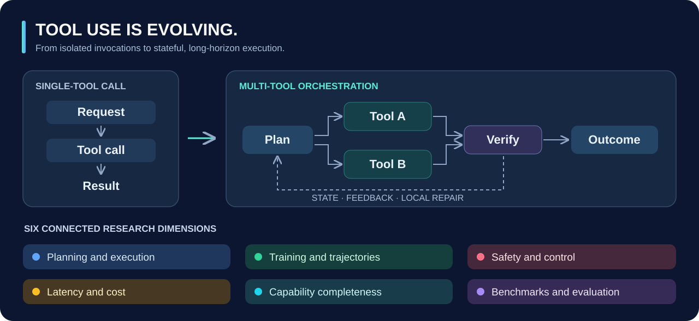
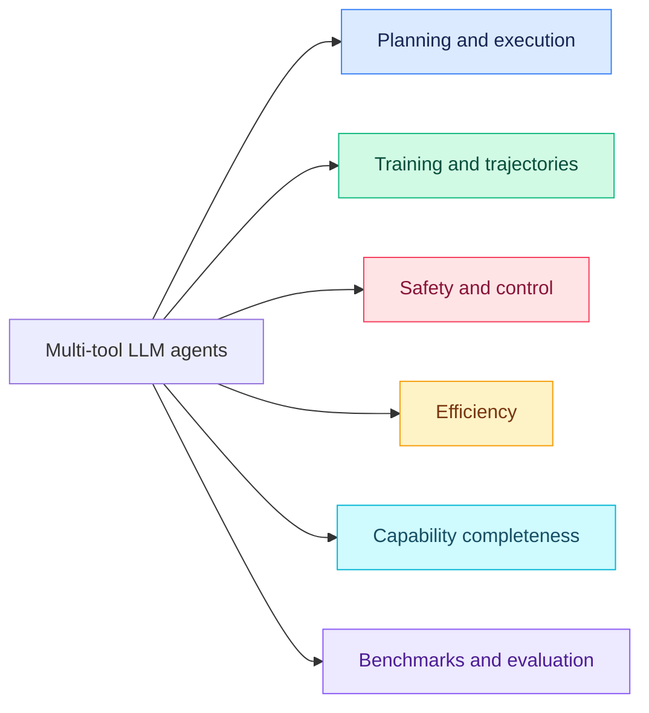

<h1 align="center">🧰 Awesome Multi-Tool LLM Agents</h1>

<h3 align="center">From Single-Tool Calls to Multi-Tool Orchestration</h3>

<p align="center">
  <a href="https://awesome.re"></a>
  <a href="https://doi.org/10.1007/s10462-026-11700-9"></a>
  <a href="https://doi.org/10.1007/s10462-026-11700-9"></a>
  <a href="https://doi.org/10.1007/s10462-026-11700-9"></a>
  <a href="https://github.com/HaoyuanXu/awesome-multi-tool-agents/stargazers"></a>
  <a href="https://github.com/HaoyuanXu/awesome-multi-tool-agents/forks"></a>
  <a href="https://github.com/HaoyuanXu/awesome-multi-tool-agents/commits/main"></a>
  <a href="https://github.com/HaoyuanXu/awesome-multi-tool-agents/issues"></a>
  <a href="CONTRIBUTING.md"></a>
  <a href="data/README.md"></a>
</p>

<p align="center">
  <a href="https://doi.org/10.1007/s10462-026-11700-9"><b>The evolution of tool use in LLM agents: from single-tool call to multi-tool orchestration</b></a><br/>
  Haoyuan Xu, Chang Li, Xinyan Ma, Xianhao Ou, et al.
</p>

<p align="center">
  <a href="https://doi.org/10.1007/s10462-026-11700-9"></a>
</p>

<p align="center">
  
</p>

<p align="center">
  <a href="#introduction">📌 Introduction</a> · <a href="#taxonomy">🗂️ Taxonomy</a> · <a href="#paper-list">📑 Paper List</a> · <a href="#benchmarks">🧪 Benchmarks</a> · <a href="#star-history">⭐ Star History</a> · <a href="#citation">📚 Citation</a>
</p>

<a id="news"></a>
## 🗞️ News

- 🚀 **2026-11-04** — Companion repository released with **240 works**, eight reading catalogs, and the survey's six-dimensional taxonomy.
- 📖 **2026-10-27** — Our survey was published in **[Artificial Intelligence Review](https://doi.org/10.1007/s10462-026-11700-9)**.

<a id="introduction"></a>
## 📌 Introduction

Multi-tool agents coordinate actions whose **ordering, arguments, or success conditions depend on earlier observations, tool results, or changes to the environment**. Moving beyond a single function call brings planning, shared state, execution feedback, recovery, and resource constraints into the same workflow.

This repository accompanies our survey and organizes the literature around **inference-time planning and execution, training and trajectory construction, safety and control, efficiency, capability completeness, and evaluation**, together with applications in software engineering, enterprise workflows, GUI/web systems, and mobile environments.

> 💡 **Explore the catalogs, suggest a paper, or share an official implementation. Contributions through issues and pull requests are welcome!**

<a id="reading-guide"></a>
## 🧭 Reading Guide

| Your goal | Suggested route |
| --- | --- |
| 🌱 Understand the field | [Foundations](docs/foundations.md) → [inference-time methods](docs/inference.md) → [benchmarks](docs/benchmarks.md) |
| 🛠️ Build an agent | [Planning and execution](docs/inference.md) → [safety and control](docs/safety.md) → [efficiency](docs/efficiency.md) |
| 🎓 Train a model | [Trajectory data, SFT, and RL](docs/training.md) → [evaluation](docs/benchmarks.md) |
| 🌍 Work with changing toolsets | [Capability completeness](docs/capability-completeness.md) → [applications](docs/applications.md) |

<a id="taxonomy"></a>
## 🗂️ Taxonomy

Six connected dimensions organize the survey. Each catalog follows the corresponding sections and includes representative starting points.

| Research dimension and catalog | Survey | Core question | Representative starting points |
| --- | --- | --- | --- |
| [🧠 Inference-time planning and execution](docs/inference.md) | §3 | How are dependent calls planned, coordinated, and repaired? | [ReAct](https://openreview.net/forum?id=WE_vluYUL-X) · [HuggingGPT](https://doi.org/10.52202/075280-1657) · [Reflexion](https://doi.org/10.52202/075280-0377) |
| [🎓 Training and trajectory construction](docs/training.md) | §4 | How are executable tool-use behaviors acquired? | [ToolLLM](https://proceedings.iclr.cc/paper_files/paper/2024/file/28e50ee5b72e90b50e7196fde8ea260e-Paper-Conference.pdf) · [APIGen](https://doi.org/10.52202/079017-1725) · [ToolRL](https://doi.org/10.52202/085713-3524) |
| [🛡️ Safety and execution control](docs/safety.md) | §5 | How are actions checked and shared state protected? | [SagaLLM](https://doi.org/10.14778/3750601.3750611) · [CRITIC](https://openreview.net/forum?id=Sx038qxjek) · [AgentDojo](https://doi.org/10.52202/079017-2636) |
| [⚡ Efficiency](docs/efficiency.md) | §6 | How can latency and cost be reduced while preserving dependencies? | [LLMCompiler](https://proceedings.mlr.press/v235/kim24y.html) · [ReWOO](https://arxiv.org/abs/2305.18323) · [FrugalGPT](https://openreview.net/forum?id=cSimKw5p6R) |
| [🌍 Capability completeness](docs/capability-completeness.md) | §7 | What happens when tools, information, or reusable skills are missing? | [LATM](https://proceedings.iclr.cc/paper_files/paper/2024/hash/ed91353f700d113e5d848c7e04a858b0-Abstract-Conference.html) · [CREATOR](https://doi.org/10.18653/v1/2023.findings-emnlp.462) · [Voyager](https://openreview.net/forum?id=ehfRiF0R3a) |
| [🧪 Benchmarks and evaluation](docs/benchmarks.md) | §8 | What does successful multi-tool execution require, and how is it measured? | [ToolHop](https://doi.org/10.18653/v1/2025.acl-long.150) · [ToolSandbox](https://doi.org/10.18653/v1/2025.findings-naacl.65) · [AppWorld](https://doi.org/10.18653/v1/2024.acl-long.850) |

<details>
<summary><b>🔎 Explore the taxonomy graph</b></summary>



</details>

<a id="paper-list"></a>
## 📑 Paper List

### 📊 Collection at a Glance

<p align="center">
  <a href="data/survey-corpus.csv"></a>
  <a href="#taxonomy"></a>
  <a href="#browse-the-catalogs"></a>
</p>

The base collection contains **240 unique works** from the survey's published supplementary corpus, with a literature cutoff of **26 July 2026**. Publication metadata follows that snapshot. Topic pages can include a work in more than one relevant catalog.

<details>
<summary><b>📅 Works by publication year</b></summary>

| Year | Works | Distribution |
| --- | ---: | --- |
| **2026** | 56 | ▰▰▰▰▰▰▰▰ |
| **2025** | 108 | ▰▰▰▰▰▰▰▰▰▰▰▰▰▰▰ |
| **2024** | 57 | ▰▰▰▰▰▰▰▰ |
| **2023** | 17 | ▰▰ |
| **2022** | 2 | ▰ |

</details>

<a id="browse-the-catalogs"></a>
### 📂 Browse the Catalogs

| Catalog | Coverage | Indexed works |
| --- | --- | ---: |
| 📖 [Foundations](docs/foundations.md) | Early tool use and related surveys | 14 |
| 🧠 [Inference](docs/inference.md) | Topological planning, long-horizon orchestration, self-improvement | 42 |
| 🎓 [Training](docs/training.md) | Training-free methods, trajectory synthesis, SFT, RL | 43 |
| 🛡️ [Safety](docs/safety.md) | Parallel execution, verification, long-horizon risks | 30 |
| ⚡ [Efficiency](docs/efficiency.md) | Parallelism, asynchronous execution, search, routing, caching | 28 |
| 🌍 [Capability completeness](docs/capability-completeness.md) | Capability boundaries, tool expansion, open environments | 14 |
| 🧪 [Benchmarks](docs/benchmarks.md) | Dependencies, horizon, interaction, state, recovery | 49 |
| 🧑‍💻 [Applications](docs/applications.md) | Software, enterprise, GUI/web, mobile, human collaboration | 57 |

Catalog counts overlap. Download the [📥 original CSV corpus](data/survey-corpus.csv) for the 240 unique bibliographic records and their section assignments.

<a id="benchmarks"></a>
## 🧪 Benchmark Quick Access

| Benchmark | Evaluation focus | Resources |
| --- | --- | --- |
| ToolHop | Multi-hop tool dependencies | [📄 Paper](https://doi.org/10.18653/v1/2025.acl-long.150) |
| Tool Decathlon | Long-horizon execution across applications | [📄 Paper](https://openreview.net/forum?id=z53s5p0qhf) |
| ToolSandbox | Stateful execution and conversational interaction | [📄 Paper](https://doi.org/10.18653/v1/2025.findings-naacl.65) · [💻 Code](https://github.com/apple-aiml-research/ToolSandbox) |
| AppWorld | Persistent state across connected applications | [📄 Paper](https://doi.org/10.18653/v1/2024.acl-long.850) · [💻 Code](https://github.com/StonyBrookNLP/appworld) |
| τ²-bench | Shared control between an agent and a simulated user | [📄 Paper](https://openreview.net/forum?id=OC2z7iSQKa) · [💻 Code](https://github.com/sierra-research/tau2-bench) |
| OSWorld | Execution in desktop applications | [📄 Paper](https://doi.org/10.52202/079017-1650) · [💻 Code](https://github.com/xlang-ai/OSWorld) |
| AgentDojo | Task utility and prompt-injection resistance | [📄 Paper](https://doi.org/10.52202/079017-2636) · [💻 Code](https://github.com/ethz-spylab/agentdojo) |

Browse the [full benchmark catalog](docs/benchmarks.md) for evaluation settings covering **topological complexity, temporal scale, dynamic environments, state persistence and self-correction**, and safety. Compare scores within their task, model, and resource settings.

<a id="applications"></a>
## 🧑‍💻 Applications

| Domain | Typical tool-mediated workflow | Catalog |
| --- | --- | --- |
| 💻 Software engineering | Retrieve repository context → edit code → execute tests → diagnose and revise | [Software engineering](docs/applications.md#software-engineering) |
| 🏢 Enterprise workflows | Gather records → reconcile information → perform authorized updates → verify the outcome | [Enterprise workflows](docs/applications.md#enterprise-workflows) |
| 🖥️ GUI and web systems | Observe an interface → navigate → manipulate content → verify state | [GUI and web systems](docs/applications.md#gui-and-web-systems) |
| 📱 Mobile systems | Explore an application → interact across screens → preserve progress → check completion | [Mobile systems](docs/applications.md#mobile-systems) |

See the [application catalog](docs/applications.md) for human-agent collaboration, cross-domain deployment requirements, and open problems.

<a id="contributing"></a>
## 🤝 Contributing

Found a relevant paper, benchmark, dataset, or official implementation? **[Open an issue](https://github.com/HaoyuanXu/awesome-multi-tool-agents/issues)** or submit a pull request using the [contribution guide](CONTRIBUTING.md).

Include the paper link, a suitable subsection, and a short explanation of its connection to multi-tool orchestration. Source details and the publication snapshot are documented in [📚 corpus provenance](data/README.md).

<a id="star-history"></a>
## ⭐ Star History

[](https://star-history.com/#HaoyuanXu/awesome-multi-tool-agents&Date)

<a id="citation"></a>
## 📚 Citation

If you find the survey or this collection useful, please cite:

```bibtex
@article{Xu_2026,
  title = {The evolution of tool use in LLM agents: from single-tool call to multi-tool orchestration},
  ISSN = {1573-7462},
  url = {http://dx.doi.org/10.1007/s10462-026-11700-9},
  DOI = {10.1007/s10462-026-11700-9},
  journal = {Artificial Intelligence Review},
  publisher = {Springer Science and Business Media LLC},
  author = {Xu, Haoyuan and Li, Chang and Ma, Xinyan and Ou, Xianhao and Zhang, Zihan and He, Tao and Liu, Xiangyu and Wang, Zixiang and Liang, Jiafeng and Chu, Zheng and Liu, Runxuan and Mu, Rongchuan and Tu, Dandan and Liu, Ming and Qin, Bing},
  year = {2026},
  month = Oct
}
```

📎 [Download BibTeX](citation.bib) · [CITATION.cff](CITATION.cff)

---

<p align="center">⭐ Star this repository to follow research on multi-tool LLM agents.</p>
